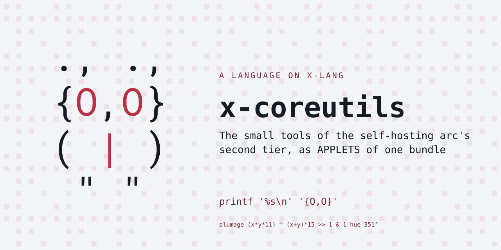

# x-coreutils

The small tools built second in the self-hosting arc, as APPLETS of
one bundle -- organized like busybox:

    x -l coreutils -- APPLET [args]...

**Two hundred applets: parity with busybox's `coreutils`
set, plus `join`, `find`, busybox's editors, `vi` and `ed`, its pager and
terminal tools, `more`, `clear` and `reset`, `strings`, `tsort`, `cal` and `dc`, its
dumpers, `hexdump`, `hd` and `xxd`, its `base32`, `crc32`, `ascii` and
`uuidgen`, its `tree` and `time`, its `fsync`, `flock`, `setsid`,
`ttysize`, `nologin` and `pipe_progress`, its `getopt` and `run-parts`,
its network tools, `wget` (http, https and ftp), `whois`, `nc`, `netcat`,
`nslookup`, `tftp`, `tftpd`, `ftpget`, `ftpput`, `httpd`, `ftpd`, `dnsd`,
`inetd`, `fakeidentd`, `telnet`, `telnetd`, `ntpd`, `dumpleases`, `pscan`, `ipcalc`,
`ssl_client`, `ssl_server`, `tcpsvd` and `udpsvd`, its `uptime`, `free`, `ps`, `minips`, `pidof`, `pgrep`, `pkill`,
`kill`, `killall`, `pwdx`, `pmap`, `pstree`, `top`, `lsof`, `fuser`, `ionice`, `taskset`, `setpriv`, `ipcs` and `ipcrm`, its `vmstat`, `iostat`, `mpstat`, `nmeter` and `watch`,
its `who`, `w` and `users`, its `tar`, `unzip` and `cpio`, its `gzip`,
`gunzip` and `zcat`, its `patch`, its `makemime`, `reformime`,
`sendmail` and `popmaildir`, and its `hostname`, `dnsdomainname`,
`hostid`, `mountpoint`, `mknod`, `mesg`, `renice`, `chrt`, `ts`, `sha384sum` and
`sha3sum`, its `cryptpw` and `mkpasswd`, and its `sysctl`, `lsmod`, `route`, `arp`, `netstat`, `ifconfig`, and `ip` with `ipaddr`, `iplink`, `iproute`, `ipneigh`, `iprule` and `iptunnel`, and its `ping`, `ping6`, `traceroute`, `traceroute6`, `arping`, `nameif`, `vconfig`, `tunctl`, `brctl` and `ether-wake`.**

    arch arp arping ascii base32 base64 basename brctl cal cat chgrp chmod
    chown chrt chroot cksum clear cmp comm cp cpio crc32 cryptpw cut date dc
    dd df diff dirname dnsd dnsdomainname dos2unix du dumpleases ed echo env
    ether-wake expand expr factor fakeidentd false find flock fold free fsync
    ftpd ftpget ftpput fuser getopt groups gunzip gzip hd head hexdump hostid
    hostname httpd id ifconfig inetd ionice install iostat ip ipaddr ipcalc
    ipcrm ipcs iplink ipneigh iproute iprule iptunnel join kill killall link
    ln logname ls lsmod lsof makemime md5sum mesg minips mkdir mkfifo mknod
    mkpasswd mktemp more mountpoint mpstat mv nameif nc netcat netstat nice
    nl nmeter nohup nologin nproc nslookup ntpd od paste patch pgrep pidof
    ping ping6 pipe_progress pkill pmap popmaildir printenv printf ps pscan
    pstree pwd readlink renice reset rev rm rmdir route run-parts sendmail
    seq setpriv setsid sha1sum sha256sum sha384sum sha3sum sha512sum shred
    shuf sleep sort split ssl_client ssl_server stat strings sum sync sysctl
    tac tail tar taskset tcpsvd tee telnet telnetd test tftp tftpd time
    timeout top touch tr traceroute traceroute6 tree true truncate ts tsort
    tty ttysize tunctl udpsvd unexpand uniq unix2dos unlink unzip uname
    uptime users uudecode uuencode uuidgen usleep vconfig vi vmstat w watch
    wc wget which who whois whoami xargs xxd yes zcat [ [[

Highlights: **every digest is byte-identical with the system tool**,
reading every byte, a NUL too -- `md5sum`, `sha1sum`, `sha256sum` and
`sha512sum` are the FIPS/RFC algorithms in x, and `cksum` is the POSIX
CRC-32 with its length fold; `sort` is a merge sort with busybox's whole
option set, keys (`-k`, `-t`) included; `expr` is a recursive-descent
parser over the argument list with its own anchored BRE matcher,
`\(...\)` capture and all; `chmod` reads an octal mode and the whole
symbolic grammar -- `X`, `s`, `t`, a copied who and the umask
included, and `chown -R`, `cp` and `du` all take `-H`, `-L` and `-P`
for what they do with a link they meet -- `du` counting a file with
several names once, as it does; `realpath` restarts its walk
over any prefix that turns out to be a link, so `/tmp` resolves
through to `/private/tmp`; `od` follows the GNU/busybox layout (not
the BSD one macOS ships) and collapses a repeated line to `*`; `diff`
is a line LCS by DP, in the normal or the unified format; `timeout`
forks the command AND a watchdog, because there is no alarm door.
`vi` is busybox's: its screen, keys and messages, each case checked
against busybox's own vi typed the same keys; it keeps busybox's one
buffer of bytes, searches it with libc's `memchr`, `strcspn` and
`memmem`, and sweeps the heap once the objects live have grown a set
amount, so its memory stays bounded however long it runs; a refresh
formats the rows again only when what they show can have changed.
Self-contained: no `(requires-lang ...)`.

## Known limits

  - **No name service.** There is no passwd or group door.  A user's
    name comes from /etc/passwd when it holds the id, then `$USER`,
    then `$LOGNAME`, then the number itself; `logname` reads
    `$LOGNAME` first.  No group has a name: `groups`, `id`, `id -gn`
    and `id -Gn` print numbers.  `chown` and `chgrp` take numeric ids
    only, and their reports name ids where GNU's name a user and a
    group: `changed group of 'f' from 0 to 20`.
  - **`date` is in the C locale.** Times are local, in the zone TZ
    names, as busybox's are, but the locale is not read, so names print
    as `LC_ALL=C date` prints them.  `date -d` and `touch -d` read a
    date spelled as an ISO 8601 date or time or as `@SECONDS`, not in
    GNU's free-form words.
  - **`tty` answers isatty**, not a terminal name: there is no ttyname
    door, so it prints `/dev/tty` or `not a tty`.
  - **`which` tests existence**, not the execute bit.
  - **Text, not binary.** An applet holds what it reads as a string,
    and a string's length stops at its first NUL byte, so `cat`, `od`,
    `wc`, `cmp`, `dd` and the other readers see a file or a stream
    only up to its first NUL -- `cmp` can call two different
    files the same.  What a tool *writes* carries its own count, so an
    escape that names NUL writes the byte: `printf '\0'`, `echo -e
    '\0'` and `tr a '\0'` all do.  `cp`, `mv` and `install`
    copy every byte, and the digests (`md5sum` to `sha3sum`, `-c` too,
    `cksum` and `sum`) read every byte; `sort -z`, `shuf -z` and
    `xargs -0` read NUL as a separator, and `env -0` writes it.
  - **`expr`'s regular expressions are its own grammar**: literals,
    `.`, `*`, bracket expressions with ranges and negation, `$`, and
    one `\(...\)` capture.  No `\{n,m\}`, `\+`, `\?` or `\|`, and no
    back-references.
  - **A mode that looks like an option** is refused, since the option
    guard sees it first: write `chmod a-w f`, not `chmod -w f`.
  - **`vi` has busybox's core so far**: moving (`h j k l`, the arrows,
    `0 $ ^ |`, Home, End, Return, `+ -`, `w b e W B E`, `f F t T ; ,`,
    `G gg H M L`, `%`, `{ }`, counts), scrolling (`^F ^B ^D ^U ^E ^Y`,
    the page keys, `z`), inserting (`i a A I o O`, Backspace, `^V`,
    `^D`, Insert for replace), the operators `d c y < >` over any of
    those motions and doubled for lines, `x X s D C Y r R J ~ U`,
    Delete, `p P`, the registers `"a` to `"z`, the marks `m` and `'` with `''`,
    `ZZ`, `ZQ`, searching with `/ ? n N` (for the text, as busybox's
    default build does, not a regular expression), and the colon
    commands over busybox's addresses (`. $ + - 'a /text/ ?text? %`,
    `,` and `;`): a line number, `:d :y :l := :s`, `:w :wq :x :wn`,
    `:r :e :f` with `%` and `#`, and `:q :n :prev :rew`; `:set` and
    busybox's options, `ai et fl ic sm ts` (autoindent, expandtab,
    flash, ignorecase, showmatch, tabstop); `:!`, a command run by
    libc's `system` as busybox runs it; and `u` and `.`, busybox's undo
    stack with its queue of typing and its repeat of the last change.
    It takes busybox's `-c CMD` (again and again), `-R`, `-H` and `-h`,
    and runs `$EXINIT`, or a `~/.exrc` of the user's own, before the first
    file.  A command busybox's vi does not have answers `is not
    implemented`, as busybox's does.  `-H` and `-h` give busybox's usage
    without the banner naming its binary, and `:version` gives the version
    x-coreutils was installed as (the `version` file `make install`
    writes; `dev` in a checkout), where busybox's gives its own.  A
    message wider than the screen waits for one Return, where busybox's
    waits again after every Return and takes no more commands.  It
    catches busybox's signals: a window resized (SIGWINCH) is measured
    and drawn again, `^Z` (SIGTSTP) gives the terminal back and stops,
    and `^C` (SIGINT) goes back to the top of the file in command mode;
    when neither the terminal nor `$LINES` and `$COLUMNS` say how big
    the window is, it asks the terminal.  SIGWINCH and SIGTSTP are
    answered when vi next waits for a key, where busybox's handlers
    answer them at once, so the two differ only while a long command
    runs.
  - **Not present**: `stty` (ioctl), `hostid`
    (gethostid) and `mknod` (device numbers), for want of a door this
    bundle will not invent; and `sha3sum`, which needs no door and is
    not written.

Paired with x-lang v0.37.1 (`lang.xon` is the checkable row).

## Try it

    make install        # into the x on PATH

    printf 'b\na\n' | x -l coreutils -- sort
    x -l coreutils -- sha512sum file.txt
    x -l coreutils -- stat -c '%n %s %A' file.txt
    ... | x -l awk '{print $1}' | x -l coreutils -- sort | x -l coreutils -- uniq -c

That last line is a real pipeline of x tools, and it works today.

## Options

Applet parity is one axis; OPTION parity is the other.  `docs/options.md`
is the generated matrix -- every busybox option per applet, which of them
this bundle accepts, and what is missing.  `make options` regenerates it
from `docs/busybox-options.x` and the option DECLARATION in `cu/options.x`
-- the one row per applet that the guard checks and the applet reads,
parsed by x-lang's `Opts`.

## Tests

    make test           # the suite, loud on any failure
    make check          # judged against tests/contract/known-failures.txt
    sh tests/linux/run.sh   # the Linux leg, as root in a privileged container

The applets whose work is the kernel's -- `sysctl`, `lsmod`, `route`, `arp`, `netstat`, `ifconfig`, `ip`, `ping`, `traceroute`, `arping`, `nameif`, `vconfig`, `tunctl`, `ionice`, `taskset`, `brctl`, `chrt`, `setpriv`, `ether-wake`, `ipcs` and `ipcrm` so far --
are tested on Linux as root, in a container tests/linux/Containerfile
builds: x at the release lang.xon declares, beside busybox.  Each case in
tests/linux/specs runs the bundle's applet and busybox on the same words
and compares what they write and their status, so the answers are the
kernel's own, whichever kernel runs it.  `ENGINE=docker` for Docker,
`SPEC=FILE` for one spec.

## Layout

    lang.xon          what this bundle IS (self-contained)
    run.x             the entry: operands mean "be the applet"
    cu/base.x         the cu/base module: loads every applet's module, and hands the entry its names
    cu/prims.x        the platform layer (byte doors, bitwise, File, the wide stat)
    cu/text.x         head tail wc comm join basename dirname
    cu/text2.x        echo printf seq rev tac fold paste tee
    cu/text3.x        yes factor expand unexpand dos2unix unix2dos split shuf base64
    cu/text4.x        uniq nl
    cu/fmt-lex.x      one reader for the format strings of printf, date and stat
    cu/sort.x         sort
    cu/trcut.x        tr and cut
    cu/fs.x           cat cp mv rm mkdir rmdir ln
    cu/fs2.x          touch pwd install mktemp cmp
    cu/fs3.x          stat du dd truncate unlink shred timeout usleep tty nohup
    cu/ls.x           ls
    cu/walk.x         the directory walk the recursive applets share
    cu/sys2.x         true false env printenv sleep which xargs
    cu/test.x         test, [ and [[: the expression grammar
    cu/date.x         date, and the strftime it needs
    cu/perm.x         chmod chown chgrp link readlink realpath mkfifo df sync
    cu/who.x          id whoami logname groups uname arch nproc nice chroot,
                      who w users
    cu/encode.x       od uuencode uudecode
    cu/expr.x         expr, and the anchored matcher it needs
    cu/diff.x         diff, normal and unified formats (LCS by DP)
    cu/diff-lex.x     which lines diff counts the same under -i -b -w
    cu/find.x         find: the expression grammar, and the walk it drives
    cu/hash.x         md5sum sha1sum cksum sum; the digests are x-lang's codecs
    cu/sha256.x       sha256sum, and the driver every digest applet shares
    cu/sha512.x       SHA-512 in x, addition masked in halves, and SHA-384 from it
    cu/vi.x           vi: busybox's editor -- its buffer, screen, keys, files
    cu/vi-move.x      vi's motions: words, characters, lines, brackets, scrolling
    cu/vi-edit.x      vi's operators over those motions, registers, marks
    cu/vi-ex.x        vi's search and : commands, over busybox's addresses
    cu/vi-set.x       vi's options: :set, and what ai et fl ic sm ts do
    cu/vi-undo.x      vi's u and .: the undo stack and the keys . replays
    cu/more.x         more, the pager, and clear and reset, the terminal tools
    cu/tsort.x        tsort: Kahn's algorithm over busybox's array of nodes
    cu/strings.x      strings: printable runs, found by libc's strspn
    cu/cal.x          cal: a month or a year, Julian to 1752
    cu/chrt.x         chrt: a process's scheduling policy and priority, shown and set through the kernel's calls
    cu/net.x          wget, over the platform's Http, and whois, over its Socket
    cu/nc.x           nc and netcat: busybox's netcat 1.10, the copy waiting on the platform's poll
    cu/dns.x          nslookup: busybox's DNS client, its queries and replies in x
    cu/tftp.x         tftp and tftpd: busybox's client and server, blocks and options over UDP
    cu/ftp.x          ftpget, ftpput and wget's ftp:// urls: busybox's FTP over a passive data connection
    cu/dump.x         busybox's dump engine: hexdump's format language, blocks, * lines
    cu/hexdump.x      hexdump, hd and xxd over it, and xxd -r
    cu/tree.x         tree: the directories drawn, as busybox draws them
    cu/time.x         time: a command run, and its rusage from wait4
    cu/base32.x       base32: five bytes to eight characters, and back
    cu/ascii.x        ascii, crc32 (the zlib CRC-32) and uuidgen
    cu/session.x      fsync, flock, setsid, ttysize, nologin, pipe_progress
    cu/httpd.x        httpd: busybox's web server -- files, httpd.conf, ranges, ETags, inetd mode or a listener
    cu/tcpsvd.x       tcpsvd and udpsvd: a program run for each connection or sender
    cu/ftpd.x         ftpd: busybox's FTP server, one connection on stdin, PASV, EPSV or PORT
    cu/dnsd.x         dnsd: busybox's small static DNS server, A and PTR from a config file
    cu/inetd.x        inetd: one listener for many services, a program or a builtin for each
    cu/fakeidentd.x   fakeidentd: the same ident answer for every query, -i, -w or a listener
    cu/telnet.x       telnet: a terminal on a TELNET connection, its options and escape menu
    cu/telnetd.x      telnetd: a login on a pseudo-terminal for each connection, -i, -w or a listener
    cu/mime.x         makemime and reformime: MIME messages made, and taken apart to files or a program
    cu/sendmail.x     sendmail: a message on stdin sent by SMTP, -S or a -H helper, AUTH LOGIN or PLAIN
    cu/popmaildir.x   popmaildir: a POP3 mailbox fetched into a maildir, by a connection helper or stdin
    cu/ntpd.x         ntpd: an NTP client and server, its clock filter, selection and discipline, -k keys
    cu/dumpleases.x   dumpleases: the leases of a udhcpd lease file, time left or when each ends
    cu/pscan.x        pscan: a TCP port scan of a host, its open ports and their services
    cu/pstree.x       pstree: the process tree, its threads too, from a process or for a user
    cu/sslclient.x    ssl_client: standard input and output through a TLS 1.3 session, to HOST, -s FD or -e PROG
    cu/sslserver.x    ssl_server: a TLS 1.3 server on the connection inetd or tcpsvd hands it, PROG on the far side
    cu/ipcalc.x       ipcalc: an address's netmask, broadcast, network, prefix and name
    cu/getopt.x       getopt, over musl's getopt_long, and the shell's quoting
    cu/runparts.x     run-parts: a directory's scripts, in order
    cu/tar.x          tar: ustar archives listed, extracted and made, z through gzip
    cu/gzip.x         gzip, gunzip and zcat, a piece at a time through Zlib's streams
    cu/sha3.x         sha3sum: SHA-3 at any width busybox takes, through x-lang's Sha3
    cu/crypt.x        cryptpw and mkpasswd, and the pw_encrypt httpd's passwords go through, over x-lang's Crypt
    cu/unzip.x        unzip: ZIP archives listed, tested and extracted, deflate through Zlib's streams
    cu/cpio.x         cpio: newc archives listed, extracted, made and copied through
    cu/dc.x           dc: the arbitrary-precision stack calculator, on bc's numbers
    cu/ed.x           ed: busybox's line editor, its commands read from standard input
    cu/patch.x        patch: unified diffs applied a hunk at a time, in one pass over each file
    cu/sysinfo.x      hostname, dnsdomainname, hostid, mountpoint, mknod, mesg, renice, ts, through libc
    cu/procps.x       uptime, free, ps (and minips, its other name), pidof, pgrep, pkill, kill, killall, pwdx and lsof, over the Host
    cu/signal.x       signal names and numbers, read as busybox's get_signum reads them
    cu/sysctl.x       sysctl: the kernel's parameters, read and written under /proc/sys
    cu/lsmod.x        lsmod: the kernel's loaded modules, from /proc/modules
    cu/route.x        route: the routing tables shown, and routes added and deleted through the kernel's ioctls
    cu/arp.x          arp: the ARP cache shown, and entries set and deleted through the kernel's ioctls
    cu/arping.x       arping: ARP requests over a packet socket, the replies timed
    cu/nameif.x       nameif: interfaces renamed to the entry their address, driver, bus or phyaddr matches
    cu/vconfig.x      vconfig: 802.1Q VLAN interfaces made, removed and set through SIOCSIFVLAN
    cu/tunctl.x       tunctl: TAP interfaces made persistent, owned and taken back through /dev/net/tun
    cu/ionice.x       ionice: a process's I/O class and priority asked and set through ioprio_get and ioprio_set
    cu/setpriv.x      setpriv: PROG run with no_new_privs and inheritable or ambient capabilities, the state shown by -d
    cu/taskset.x      taskset: a process's CPU affinity shown and set, as a mask or a list
    cu/ipcs.x         ipcs: the System V message queues, shared memory and semaphores, and the calls on each kernel
    cu/ipcrm.x        ipcrm: System V message queues, shared memory and semaphores removed by id or key
    cu/brctl.x        brctl: bridges made and joined through the SIOCBR ioctls, set and shown through /sys/class/net
    cu/etherwake.x    ether-wake: a Wake-On-LAN magic packet sent over a packet socket
    cu/netstat.x      netstat: the kernel's sockets, each kind and side, with names, services and processes
    cu/ifconfig.x     ifconfig: the interfaces shown, and addresses, flags and settings set through the kernel's ioctls
    cu/ip.x           the links and their addresses shown, and the netlink calls the ip verbs share
    cu/ip-main.x      ip, ipaddr and iplink: the common options, then the object word hands the rest to its verb
    cu/ipset.x        ip addr add, change, delete and flush, ip link set, add and delete, over netlink and the ioctls
    cu/iproute.x      ip route and iproute: the routes listed, flushed, changed and asked after, over netlink
    cu/ipneigh.x      ip neigh and ipneigh: the neighbour tables shown and flushed, over netlink
    cu/iprule.x       ip rule and iprule: the routing rules listed, added and deleted, over netlink
    cu/iptunnel.x     ip tunnel and iptunnel: IPv4 tunnels added, changed, deleted and shown, through the tunnel ioctls
    cu/ping.x         ping and ping6: echo requests over a raw socket, the replies timed
    cu/traceroute.x   traceroute and traceroute6: the hops to a host, timed
    cu/inet.x         what the network tables share: addresses, names through the C library, the ioctls' buffers
    cu/top.x          top: its screens, keys and memory view, over the Host
    cu/vmstat.x       vmstat, and the compact numbers and %.2f the counter applets share
    cu/iostat.x       iostat: the CPU's shares and each disk's transfers, over the Host
    cu/mpstat.x       mpstat: each processor's shares and interrupt rates, over the Host
    cu/nmeter.x       nmeter: a line of readings laid out by a format string, over the Host
    cu/pmap.x         pmap: a process's memory regions, over the Host
    cu/watch.x        watch: a command run every period under a header, through sh -c or exec
    cu/fuser.x        fuser: the processes that hold a file, a file system or a port, over the Host
    cu/options.x      each applet's option declaration and help text
    cu/applets.x      Applets, the class whose statics are the applets, each imported from its module
    cu/cli.x          the option parse, cu-run, cu-main
    tests/            markdown specs + the platform's runner, vendored nowhere
    tests/root.x      every module's exports bound in the root, where the specs read them

