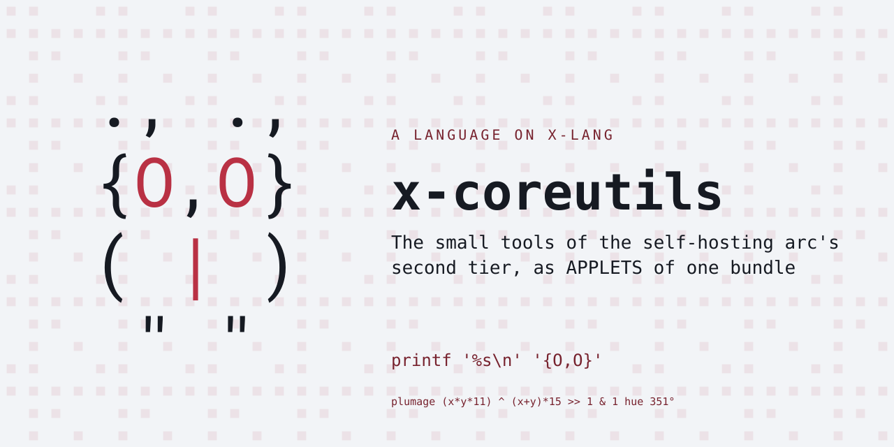
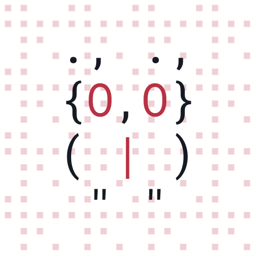

# x-coreutils

BusyBox's applets on [x-lang](https://github.com/jonruttan/x-lang), as
one bundle:

    x -l coreutils -- APPLET [args]...

The aim is every BusyBox applet, each checked against BusyBox 1.36.1,
with BusyBox's behaviour where it and GNU differ.  The applets, one to a
line:

    ar
    arch
    arp
    arping
    ascii
    base32
    base64
    bc
    basename
    brctl
    bunzip2
    bzcat
    bzip2
    cal
    cat
    chgrp
    chmod
    chown
    chroot
    chrt
    cksum
    clear
    cmp
    comm
    cp
    cpio
    crc32
    cryptpw
    cut
    date
    dc
    dd
    df
    dhcprelay
    diff
    dirname
    dmesg
    dnsd
    dnsdomainname
    dos2unix
    du
    dumpleases
    echo
    ed
    env
    ether-wake
    expand
    expr
    factor
    fakeidentd
    fallocate
    false
    find
    flock
    fold
    free
    fsync
    ftpd
    ftpget
    ftpput
    fuser
    getopt
    groups
    gunzip
    gzip
    hd
    head
    hexdump
    hostid
    hostname
    httpd
    id
    ifconfig
    ifplugd
    inetd
    install
    ionice
    iostat
    ip
    ipaddr
    ipcalc
    ipcrm
    ipcs
    iplink
    ipneigh
    iproute
    iprule
    iptunnel
    join
    kill
    killall
    killall5
    klogd
    link
    linux32
    linux64
    ln
    logger
    logread
    logname
    ls
    lsmod
    lsof
    lzcat
    lzma
    makemime
    md5sum
    mesg
    minips
    mkdir
    mkfifo
    mknod
    mkpasswd
    mktemp
    more
    mountpoint
    mpstat
    mv
    nameif
    nc
    netcat
    netstat
    nice
    nl
    nmeter
    nohup
    nologin
    nproc
    nsenter
    nslookup
    ntpd
    od
    paste
    patch
    pgrep
    pidof
    ping
    ping6
    pipe_progress
    pkill
    pmap
    popmaildir
    powertop
    printenv
    printf
    ps
    pscan
    pstree
    pwd
    pwdx
    rdate
    readlink
    realpath
    reformime
    renice
    reset
    rev
    rm
    rmdir
    route
    run-parts
    sendmail
    seq
    setarch
    setpriv
    setsid
    sha1sum
    sha256sum
    sha384sum
    sha3sum
    sha512sum
    shred
    shuf
    sleep
    smemcap
    sort
    split
    ssl_client
    ssl_server
    stat
    strings
    stty
    sum
    sync
    sysctl
    syslogd
    tac
    tail
    tar
    taskset
    tcpsvd
    tee
    telnet
    telnetd
    test
    tftp
    tftpd
    time
    timeout
    top
    touch
    tr
    traceroute
    traceroute6
    tree
    true
    truncate
    ts
    tsort
    tty
    ttysize
    tunctl
    udhcpc
    udhcpc6
    udhcpd
    udpsvd
    uname
    unexpand
    uniq
    unix2dos
    unlink
    unlzma
    unshare
    unzip
    uptime
    users
    usleep
    uudecode
    uuencode
    uuidgen
    vconfig
    vi
    vmstat
    w
    watch
    wc
    wget
    which
    who
    whoami
    whois
    xargs
    xxd
    yes
    zcat
    zcip
    [
    [[

Highlights: **every digest is byte-identical with the system tool**,
reading every byte, a NUL too -- `md5sum`, `sha1sum`, `sha256sum` and
`sha512sum` are the FIPS/RFC algorithms in x, and `cksum` is the POSIX
CRC-32 with its length fold; `sort` is a merge sort with busybox's whole
option set, keys (`-k`, `-t`) included; `expr` is a recursive-descent
parser over the argument list with its own anchored BRE matcher,
`\(...\)` capture and all; `chmod` reads an octal mode and the whole
symbolic grammar -- `X`, `s`, `t`, a copied who and the umask
included, and `chown -R`, `cp` and `du` all take `-H`, `-L` and `-P`
for what they do with a link they meet -- `du` counting a file with
several names once, as it does; `realpath` restarts its walk
over any prefix that turns out to be a link, so `/tmp` resolves
through to `/private/tmp`; `od` follows the GNU/busybox layout (not
the BSD one macOS ships) and collapses a repeated line to `*`; `diff`
is a line LCS by DP, in the normal or the unified format; `timeout`
forks the command AND a watchdog, because there is no alarm door.
`vi` is busybox's: its screen, keys and messages, each case checked
against busybox's own vi typed the same keys; it keeps busybox's one
buffer of bytes, searches it with libc's `memchr`, `strcspn` and
`memmem`, and sweeps the heap once the objects live have grown a set
amount, so its memory stays bounded however long it runs; a refresh
formats the rows again only when what they show can have changed.
[docs/vi-card.md](docs/vi-card.md) is its card: the keys and colon
commands in tables, and rows that type keys at vi and show the file they
leave, which `make vi-card` runs.
Self-contained: no `(requires-lang ...)`.

## Known limits

  - **Names are libc's.** A user's or group's name and id come from
    `getpwuid`, `getgrgid`, `getpwnam` and `getgrnam`, reached through
    the FFI, and print as the number where the system has no name.
    `chown` and `chgrp` take a name or an id.
  - **`date` is in the C locale.** Times are local, in the zone TZ
    names, as busybox's are, but the locale is not read, so names print
    as `LC_ALL=C date` prints them.  `date -d` and `touch -d` read a
    date spelled as an ISO 8601 date or time or as `@SECONDS`, not in
    GNU's free-form words.
  - **`tty` answers isatty**, not a terminal name: there is no ttyname
    door, so it prints `/dev/tty` or `not a tty`.
  - **`which` tests existence**, not the execute bit.
  - **NUL bytes.** `cat`, `tee`, `head`, `tail`, `wc`, `tr`, `od`,
    `base64`, `dd`, `dos2unix`, `unix2dos`, `split`, `uuencode` and
    `uudecode` carry them, `cmp` and `diff` compare files that hold
    them, `cp`, `mv` and `install` copy every byte, and the digests
    (`md5sum` to `sha3sum`, `-c` too, `cksum` and `sum`) read every
    byte.  `sort -z`, `shuf -z` and `xargs -0` read NUL as a separator,
    and `env -0` writes it.  An escape that names NUL writes the byte:
    `printf '\0'`, `echo -e '\0'` and `tr a '\0'` all do.  The other
    text tools are not checked on input that holds a NUL.
  - **`expr`'s regular expressions are its own grammar**: literals,
    `.`, `*`, bracket expressions with ranges and negation, `$`, and
    one `\(...\)` capture.  No `\{n,m\}`, `\+`, `\?` or `\|`, and no
    back-references.
  - **A mode that looks like an option** is refused, since the option
    guard sees it first: write `chmod a-w f`, not `chmod -w f`.
  - **`vi` has busybox's core so far**: moving (`h j k l`, the arrows,
    `0 $ ^ |`, Home, End, Return, `+ -`, `w b e W B E`, `f F t T ; ,`,
    `G gg H M L`, `%`, `{ }`, counts), scrolling (`^F ^B ^D ^U ^E ^Y`,
    the page keys, `z`), inserting (`i a A I o O`, Backspace, `^V`,
    `^D`, Insert for replace), the operators `d c y < >` over any of
    those motions and doubled for lines, `x X s D C Y r R J ~ U`,
    Delete, `p P`, the registers `"a` to `"z`, the marks `m` and `'` with `''`,
    `ZZ`, `ZQ`, searching with `/ ? n N` (for the text, as busybox's
    default build does, not a regular expression), and the colon
    commands over busybox's addresses (`. $ + - 'a /text/ ?text? %`,
    `,` and `;`): a line number, `:d :y :l := :s`, `:w :wq :x :wn`,
    `:r :e :f` with `%` and `#`, and `:q :n :prev :rew`; `:set` and
    busybox's options, `ai et fl ic sm ts` (autoindent, expandtab,
    flash, ignorecase, showmatch, tabstop); `:!`, a command run by
    libc's `system` as busybox runs it; and `u` and `.`, busybox's undo
    stack with its queue of typing and its repeat of the last change.
    It takes busybox's `-c CMD` (again and again), `-R`, `-H` and `-h`,
    and runs `$EXINIT`, or a `~/.exrc` of the user's own, before the first
    file.  A command busybox's vi does not have answers `is not
    implemented`, as busybox's does.  `-H` and `-h` give busybox's usage
    without the banner naming its binary, and `:version` gives the version
    x-coreutils was installed as (the `version` file `make install`
    writes; `dev` in a checkout), where busybox's gives its own.  A
    message wider than the screen waits for one Return, where busybox's
    waits again after every Return and takes no more commands.  It
    catches busybox's signals: a window resized (SIGWINCH) is measured
    and drawn again, `^Z` (SIGTSTP) gives the terminal back and stops,
    and `^C` (SIGINT) goes back to the top of the file in command mode;
    when neither the terminal nor `$LINES` and `$COLUMNS` say how big
    the window is, it asks the terminal.  SIGWINCH and SIGTSTP are
    answered when vi next waits for a key, where busybox's handlers
    answer them at once, so the two differ only while a long command
    runs.

Paired with x-lang v0.62.0 (`bundle.xon` is the checkable row).

## Try it

    make install        # into the x on PATH

    printf 'b\na\n' | x -l coreutils -- sort
    x -l coreutils -- sha512sum file.txt
    x -l coreutils -- stat -c '%n %s %A' file.txt
    ... | x -l awk '{print $1}' | x -l coreutils -- sort | x -l coreutils -- uniq -c

That last line is a real pipeline of x tools, and it works today.

[docs/card.md](docs/card.md) is the card: the applets by what they do,
in tables, and rows that run them, which `make card` checks.

## Options

Applet parity is one axis; OPTION parity is the other.  `docs/options.md`
is the generated matrix -- every busybox option per applet, which of them
this bundle accepts, and what is missing.  `make options` regenerates it
from `docs/busybox-options.x` and the option DECLARATION in `lib/coreutils/options.x`
-- the one row per applet that the guard checks and the applet reads,
parsed by x-lang's `Opts`.  The total is written to the terminal, not
the page, so two applets' PRs do not both change one line of it.

## Tests

    make test           # the suite, loud on any failure
    make check          # judged against tests/contract/known-failures.txt
    make card           # docs/card.md: its format and its rows
    sh tests/linux/run.sh   # the Linux leg, as root in a privileged container

The applets whose work is the kernel's are tested on Linux as root, in a
container tests/linux/Containerfile builds: x at the release bundle.xon
declares, beside busybox.  Each case in tests/linux/specs runs the
bundle's applet and busybox on the same words and compares what they
write and their status, so the answers are the kernel's own, whichever
kernel runs it.  `ENGINE=docker` for Docker, `SPEC=FILE` for one spec.
The applets tested there so far:

- `arp`
- `arping`
- `brctl`
- `chrt`
- `dhcprelay`
- `dmesg`
- `ether-wake`
- `fallocate`
- `ifconfig`
- `ifplugd`
- `ionice`
- `ip`
- `ipcrm`
- `ipcs`
- `killall5`
- `klogd`
- `linux32`
- `linux64`
- `logger`
- `logread`
- `lsmod`
- `minips`
- `nameif`
- `netstat`
- `nsenter`
- `ping`
- `powertop`
- `pstree`
- `route`
- `setarch`
- `setpriv`
- `smemcap`
- `stty`
- `sysctl`
- `syslogd`
- `taskset`
- `traceroute`
- `tunctl`
- `udhcpc`
- `udhcpc6`
- `udhcpd`
- `unshare`
- `vconfig`
- `zcip`

## Layout

    bundle.xon                   what this bundle IS (self-contained)
    lib/                         the import root: lib/coreutils/ holds every module
    lib/coreutils/applets.x      Applets, the class whose statics are the applets, each imported from its module
    lib/coreutils/ar.x           ar: an ar archive listed, its members made or written out, or written again with FILEs added
    lib/coreutils/arp.x          arp: the ARP cache shown, and entries set and deleted through the kernel's ioctls
    lib/coreutils/arping.x       arping: ARP requests over a packet socket, the replies timed
    lib/coreutils/ascii.x        ascii, crc32 (the zlib CRC-32) and uuidgen
    lib/coreutils/base.x         the coreutils/base module: loads every applet's module, and hands the entry its names
    lib/coreutils/base32.x       base32: five bytes to eight characters, and back
    lib/coreutils/bc.x           bc: the arbitrary-precision calculator language, read a statement at a time and run
    lib/coreutils/bcnum.x        bc's numbers and their printing, which bc and dc share
    lib/coreutils/brctl.x        brctl: bridges made and joined through the SIOCBR ioctls, set and shown through /sys/class/net
    lib/coreutils/cal.x          cal: a month or a year, Julian to 1752
    lib/coreutils/chrt.x         chrt: a process's scheduling policy and priority, shown and set through the kernel's calls
    lib/coreutils/cli.x          the option parse, cu-run, cu-main
    lib/coreutils/cpio.x         cpio: newc archives listed, extracted, made and copied through
    lib/coreutils/crypt.x        cryptpw and mkpasswd, and the pw_encrypt httpd's passwords go through, over x-lang's Crypt
    lib/coreutils/date.x         date, and the strftime it needs
    lib/coreutils/dc.x           dc: the arbitrary-precision stack calculator, on bc's numbers
    lib/coreutils/dhcprelay.x    dhcprelay: busybox's DHCP relay, requests to a server and its replies back by xid
    lib/coreutils/diff-lex.x     which lines diff counts the same under -i -b -w
    lib/coreutils/diff.x         diff, normal and unified formats (LCS by DP)
    lib/coreutils/dmesg.x        dmesg: the kernel's ring, through klogctl, printed or cleared
    lib/coreutils/dns.x          nslookup: busybox's DNS client, its queries and replies in x
    lib/coreutils/dnsd.x         dnsd: busybox's small static DNS server, A and PTR from a config file
    lib/coreutils/dump.x         busybox's dump engine: hexdump's format language, blocks, * lines
    lib/coreutils/dumpleases.x   dumpleases: the leases of a udhcpd lease file, time left or when each ends
    lib/coreutils/ed.x           ed: busybox's line editor, its commands read from standard input
    lib/coreutils/encode.x       od uuencode uudecode
    lib/coreutils/etherwake.x    ether-wake: a Wake-On-LAN magic packet sent over a packet socket
    lib/coreutils/expr.x         expr, and the anchored matcher it needs
    lib/coreutils/fakeidentd.x   fakeidentd: the same ident answer for every query, -i, -w or a listener
    lib/coreutils/fallocate.x    fallocate: LEN bytes set aside for FILE from OFS, posix_fallocate or Darwin's F_PREALLOCATE
    lib/coreutils/find.x         find: the expression grammar, and the walk it drives
    lib/coreutils/fmt-lex.x      one reader for the format strings of printf, date and stat
    lib/coreutils/fs.x           cat cp mv rm mkdir rmdir ln
    lib/coreutils/fs2.x          touch pwd install mktemp cmp
    lib/coreutils/fs3.x          stat du dd truncate unlink shred timeout usleep tty nohup
    lib/coreutils/ftp.x          ftpget, ftpput and wget's ftp:// urls: busybox's FTP over a passive data connection
    lib/coreutils/ftpd.x         ftpd: busybox's FTP server, one connection on stdin, PASV, EPSV or PORT
    lib/coreutils/fuser.x        fuser: the processes that hold a file, a file system or a port, over the Host
    lib/coreutils/getopt.x       getopt, over musl's getopt_long, and the shell's quoting
    lib/coreutils/gzip.x         gzip, gunzip, zcat, bzip2, bunzip2, bzcat, unlzma, lzcat and lzma, a piece at a time through x-lang's streams
    lib/coreutils/hash.x         md5sum sha1sum cksum sum; the digests are x-lang's codecs
    lib/coreutils/hexdump.x      hexdump, hd and xxd over it, and xxd -r
    lib/coreutils/httpd.x        httpd: busybox's web server -- files, httpd.conf, ranges, ETags, inetd mode or a listener
    lib/coreutils/ifconfig.x     ifconfig: the interfaces shown, and addresses, flags and settings set through the kernel's ioctls
    lib/coreutils/ifplugd.x      ifplugd: a script run as an interface's link comes and goes, read through ethtool, MII, IFF_RUNNING or netlink
    lib/coreutils/inet.x         what the network tables share: addresses, names through the C library, the ioctls' buffers
    lib/coreutils/inetd.x        inetd: one listener for many services, a program or a builtin for each
    lib/coreutils/ionice.x       ionice: a process's I/O class and priority asked and set through ioprio_get and ioprio_set
    lib/coreutils/iostat.x       iostat: the CPU's shares and each disk's transfers, over the Host
    lib/coreutils/ip-main.x      ip, ipaddr and iplink: the common options, then the object word hands the rest to its verb
    lib/coreutils/ip.x           the links and their addresses shown, and the netlink calls the ip verbs share
    lib/coreutils/ipcalc.x       ipcalc: an address's netmask, broadcast, network, prefix and name
    lib/coreutils/ipcrm.x        ipcrm: System V message queues, shared memory and semaphores removed by id or key
    lib/coreutils/ipcs.x         ipcs: the System V message queues, shared memory and semaphores, and the calls on each kernel
    lib/coreutils/ipneigh.x      ip neigh and ipneigh: the neighbour tables shown and flushed, over netlink
    lib/coreutils/iproute.x      ip route and iproute: the routes listed, flushed, changed and asked after, over netlink
    lib/coreutils/iprule.x       ip rule and iprule: the routing rules listed, added and deleted, over netlink
    lib/coreutils/ipset.x        ip addr add, change, delete and flush, ip link set, add and delete, over netlink and the ioctls
    lib/coreutils/iptunnel.x     ip tunnel and iptunnel: IPv4 tunnels added, changed, deleted and shown, through the tunnel ioctls
    lib/coreutils/klogd.x        klogd: the kernel's messages, read through klogctl, to syslog
    lib/coreutils/logger.x       logger: a message, or standard input's lines, to the system log through syslog(3)
    lib/coreutils/logread.x      logread: the messages in syslogd's shared buffer, once or as it grows
    lib/coreutils/ls.x           ls
    lib/coreutils/lsmod.x        lsmod: the kernel's loaded modules, from /proc/modules
    lib/coreutils/mime.x         makemime and reformime: MIME messages made, and taken apart to files or a program
    lib/coreutils/more.x         more, the pager, and clear and reset, the terminal tools
    lib/coreutils/mpstat.x       mpstat: each processor's shares and interrupt rates, over the Host
    lib/coreutils/nameif.x       nameif: interfaces renamed to the entry their address, driver, bus or phyaddr matches
    lib/coreutils/nc.x           nc and netcat: busybox's netcat 1.10, the copy waiting on the platform's poll
    lib/coreutils/net.x          wget, over the platform's Http, and whois, over its Socket
    lib/coreutils/netstat.x      netstat: the kernel's sockets, each kind and side, with names, services and processes
    lib/coreutils/nmeter.x       nmeter: a line of readings laid out by a format string, over the Host
    lib/coreutils/nsenter.x      nsenter: PROG run in other processes' namespaces, entered through setns, its root and directory too
    lib/coreutils/ntpd.x         ntpd: an NTP client and server, its clock filter, selection and discipline, -k keys
    lib/coreutils/options.x      each applet's option declaration and help text
    lib/coreutils/patch.x        patch: unified diffs applied a hunk at a time, in one pass over each file
    lib/coreutils/perm.x         chmod chown chgrp link readlink realpath mkfifo df sync
    lib/coreutils/ping.x         ping and ping6: echo requests over a raw socket, the replies timed
    lib/coreutils/pmap.x         pmap: a process's memory regions, over the Host
    lib/coreutils/popmaildir.x   popmaildir: a POP3 mailbox fetched into a maildir, by a connection helper or stdin
    lib/coreutils/powertop.x     powertop: the wakeups the kernel counts and their causes, the C-states' residency
    lib/coreutils/prims.x        the platform layer (byte doors, bitwise, File, the wide stat)
    lib/coreutils/procps.x       uptime, free, ps (and minips, its other name), pidof, pgrep, pkill, kill, killall, killall5, pwdx and lsof, over the Host
    lib/coreutils/pscan.x        pscan: a TCP port scan of a host, its open ports and their services
    lib/coreutils/pstree.x       pstree: the process tree, its threads too, from a process or for a user
    lib/coreutils/rdate.x        rdate: the time asked of a server by RFC 868, set and shown
    lib/coreutils/route.x        route: the routing tables shown, and routes added and deleted through the kernel's ioctls
    lib/coreutils/run.x          the entry, coreutils/run: operands mean "be the applet"
    lib/coreutils/runparts.x     run-parts: a directory's scripts, in order
    lib/coreutils/sendmail.x     sendmail: a message on stdin sent by SMTP, -S or a -H helper, AUTH LOGIN or PLAIN
    lib/coreutils/session.x      fsync, flock, setsid, ttysize, nologin, pipe_progress
    lib/coreutils/setarch.x      setarch, linux32, linux64: PROG run under the personality linux32 or linux64 names, -R without address randomization
    lib/coreutils/setpriv.x      setpriv: PROG run with no_new_privs and inheritable or ambient capabilities, the state shown by -d
    lib/coreutils/sha256.x       sha256sum, and the driver every digest applet shares
    lib/coreutils/sha3.x         sha3sum: SHA-3 at any width busybox takes, through x-lang's Sha3
    lib/coreutils/sha512.x       sha512sum sha384sum; the digests are x-lang's codecs
    lib/coreutils/signal.x       signal names and numbers, read as busybox's get_signum reads them
    lib/coreutils/smemcap.x      smemcap: what smem reads of /proc, as a tar stream on standard output
    lib/coreutils/sort.x         sort
    lib/coreutils/sslclient.x    ssl_client: standard input and output through a TLS 1.3 session, to HOST, -s FD or -e PROG
    lib/coreutils/sslserver.x    ssl_server: a TLS 1.3 server on the connection inetd or tcpsvd hands it, PROG on the far side
    lib/coreutils/strings.x      strings: printable runs, found by libc's strspn
    lib/coreutils/stty.x         stty: a terminal's settings, shown and changed through x's Term
    lib/coreutils/sys2.x         true false env printenv sleep which xargs
    lib/coreutils/sysctl.x       sysctl: the kernel's parameters, read and written under /proc/sys
    lib/coreutils/sysinfo.x      hostname, dnsdomainname, hostid, mountpoint, mknod, mesg, renice, ts, through libc
    lib/coreutils/syslogd.x      syslogd: the system log daemon, /dev/log to files, the shared buffer, /dev/kmsg or UDP
    lib/coreutils/tar.x          tar: ustar archives listed, extracted and made, z through gzip
    lib/coreutils/taskset.x      taskset: a process's CPU affinity shown and set, as a mask or a list
    lib/coreutils/tcpsvd.x       tcpsvd and udpsvd: a program run for each connection or sender
    lib/coreutils/telnet.x       telnet: a terminal on a TELNET connection, its options and escape menu
    lib/coreutils/telnetd.x      telnetd: a login on a pseudo-terminal for each connection, -i, -w or a listener
    lib/coreutils/test.x         test, [ and [[: the expression grammar
    lib/coreutils/text.x         head tail wc comm join basename dirname
    lib/coreutils/text2.x        echo printf seq rev tac fold paste tee
    lib/coreutils/text3.x        yes factor expand unexpand dos2unix unix2dos split shuf base64
    lib/coreutils/text4.x        uniq nl
    lib/coreutils/tftp.x         tftp and tftpd: busybox's client and server, blocks and options over UDP
    lib/coreutils/time.x         time: a command run, and its rusage from wait4
    lib/coreutils/top.x          top: its screens, keys and memory view, over the Host
    lib/coreutils/traceroute.x   traceroute and traceroute6: the hops to a host, timed
    lib/coreutils/trcut.x        tr and cut
    lib/coreutils/tree.x         tree: the directories drawn, as busybox draws them
    lib/coreutils/tsort.x        tsort: Kahn's algorithm over busybox's array of nodes
    lib/coreutils/tunctl.x       tunctl: TAP interfaces made persistent, owned and taken back through /dev/net/tun
    lib/coreutils/udhcp.x        the DHCP layer udhcpd, udhcpc, udhcpc6 and dhcprelay share: options, packets, sockets, the ARP probe
    lib/coreutils/udhcpc.x       udhcpc: busybox's DHCP client, a lease asked for, bound, renewed and released
    lib/coreutils/udhcpc6.x      udhcpc6: busybox's DHCPv6 client, an address or a prefix asked for, bound, renewed and released
    lib/coreutils/udhcpd.x       udhcpd: busybox's DHCP server, leases offered, ACKed and written out
    lib/coreutils/unshare.x      unshare: PROG run in new namespaces, bound to files, as root in a user namespace
    lib/coreutils/unzip.x        unzip: ZIP archives listed, tested and extracted, deflate through Zlib's streams
    lib/coreutils/vconfig.x      vconfig: 802.1Q VLAN interfaces made, removed and set through SIOCSIFVLAN
    lib/coreutils/vi-edit.x      vi's operators over those motions, registers, marks
    lib/coreutils/vi-ex.x        vi's search and : commands, over busybox's addresses
    lib/coreutils/vi-move.x      vi's motions: words, characters, lines, brackets, scrolling
    lib/coreutils/vi-set.x       vi's options: :set, and what ai et fl ic sm ts do
    lib/coreutils/vi-syntax.x    vi's syntax and theme, x's own: rows in a theme's colours
    lib/coreutils/vi-undo.x      vi's u and .: the undo stack and the keys . replays
    lib/coreutils/vi.x           vi: busybox's editor -- its buffer, screen, keys, files
    lib/coreutils/vmstat.x       vmstat, and the compact numbers and %.2f the counter applets share
    lib/coreutils/walk.x         the directory walk the recursive applets share
    lib/coreutils/watch.x        watch: a command run every period under a header, through sh -c or exec
    lib/coreutils/who.x          id whoami logname groups uname arch nproc nice chroot, who w users
    lib/coreutils/zcip.x         zcip: a ZeroConf link-local address probed and announced over ARP, then defended
    tests/                       markdown specs + the platform's runner, vendored nowhere
    tests/root.x                 every module's exports bound in the root, where the specs read them

